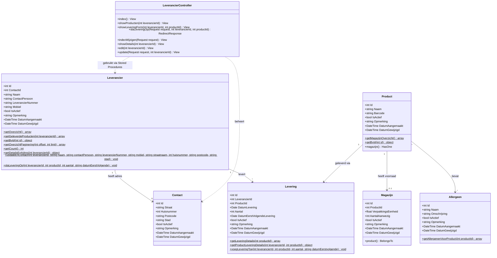

# Class Diagram - Magazijn Jamin (BE-opdracht 03)

**Opdracht:** BE-opdracht 03  
**Auteur:** YousufzaiS  
**Klas:** IO-SD-2509AB  
**Onderdeel:** Wijzigen Leverancier  

---

## 1. Mermaid Klassendiagram

---

## 2. Toelichting Architectuur (MVC & OOP)

1. **Model Laag (OOP)**:
   - Alle modellen vertegenwoordigen de entiteiten in de database.
   - Alle databasequery's worden afgehandeld via **MySQL Stored Procedures** (geen inline SQL in de applicatielaag).
2. **Controller Laag**:
   - `LeverancierController` fungeert als de dirigent tussen HTTP verzoeken en de modellen.
   - Valideert formulierinvoer en geeft bewerkte data door aan de views.
3. **View Laag (Blade)**:
   - `leverancier.wijzigen-overzicht`: Wireframe-02 met server-side pagination (max 4 records per pagina).
   - `leverancier.details`: Wireframe-03 toont detailkaart met leveranciers- en contactgegevens.
   - `leverancier.wijzigen-form`: Wireframe-04 bewerkingsformulier met 3-seconden redirect na succesvolle opslag.
